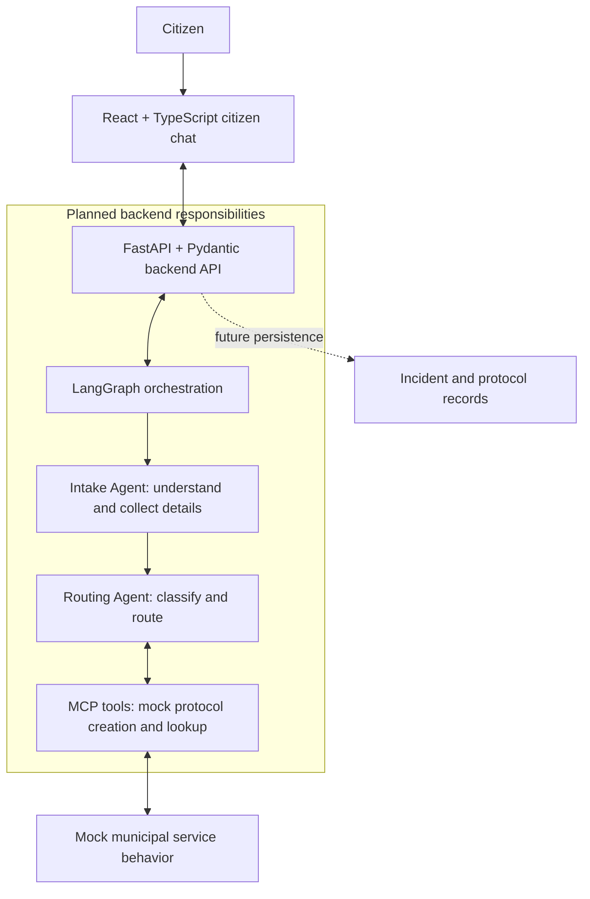

# Architecture

CivicFlow's target MVP is a text-based, AI-assisted municipal incident and
service-request experience. This reference separates the working foundation
from planned capabilities; it does not define new API or storage contracts.

## Implemented today

| Component | Current responsibility |
| --- | --- |
| `frontend/` | React + TypeScript shell, Vite, native CSS and CSS Modules; coming-soon chat placeholder, no API calls or authentication. Node.js 22 and npm. |
| `backend/` | Python 3.12, FastAPI, Pydantic v2 and uv; `GET /health` returns `{"status":"ok"}`, with generated `/docs`, `/redoc`, and `/openapi.json`. |
| `compose.yaml` | Local Vite and Uvicorn servers, source mounts, isolated dependency volumes, and backend health check. |
| `.github/workflows/ci.yml` | Independent `backend` and `frontend` checks for lint, formatting/type checks, tests, and frontend build as applicable. |

Each application owns its dependencies, lockfile, settings, tests, and tooling.
The root holds shared conventions and project documentation; `docs/` holds
cross-application references. Local secrets and generated artifacts stay out
of version control. Existing `.env.example` templates contain safe configuration;
browser `VITE_*` settings must never contain secrets.

## Development communication

`frontend/src/config/env.ts` reads `VITE_API_BASE_URL`, defaulting to
`http://localhost:8000`. The shell exposes this as a data attribute and makes
no requests. Setting it to `/api` allows future browser requests to use the
Vite development proxy in `frontend/vite.config.ts`.

Vite forwards `/api` requests to `API_PROXY_TARGET` (default
`http://localhost:8000`) and strips the prefix: `/api/health` reaches backend
`/health`. Compose sets the browser API base to `/api` and the server-only
target to `http://backend:8000`. Vite resolves the Docker service hostname
inside the Compose network; the browser uses `/api`. The shell can start
independently of backend health. Production hosting and routing are not defined.

See the [root quickstart](../README.md#development-with-docker-compose),
[frontend guide](../frontend/README.md), and [backend guide](../backend/README.md)
for commands and configuration.

## Target MVP components (planned)

Only the frontend and backend foundations exist today. All request-processing
connections below are planned. Persistence is future work and is not required
to run the current application.

| Planned component | Responsibility and boundary |
| --- | --- |
| Citizen chat | Collect text input and display follow-up questions and results. The browser communicates with the backend; orchestration and tool access belong behind the API. |
| Backend API | Validate inputs and outputs with Pydantic and coordinate the interaction. Chat endpoints and data contracts are not yet defined. |
| LangGraph orchestration | Coordinate the Intake Agent, which understands requests and collects missing details, and the Routing Agent, which classifies and routes them. LangGraph is not installed yet. |
| MCP tools | Provide mock municipal protocol creation and lookup behind a tool boundary. No MCP implementation or live government-system integration exists. |
| Future persistence | Store incident and protocol records. No database, schema, or persistence implementation has been chosen in this foundation. |

## Anticipated citizen-request flow

1. A citizen describes an incident or service request in the planned chat.
2. The frontend sends the interaction to the backend API.
3. LangGraph coordinates the Intake Agent to understand the request and ask
   for missing details through the chat.
4. The Routing Agent classifies and routes the request, using MCP tools for
   mock municipal protocol creation or lookup as appropriate.
5. The backend returns the result for the chat to display, such as a mock
   protocol reference or status. Future persistence would retain incident and
   protocol records; durable storage is not available today.

AI providers, request schemas, chat endpoints, routing rules, and production
infrastructure remain unspecified. Geospatial analysis, multimodal input,
and monitoring/oversight are future ideas outside the current MVP scope.
