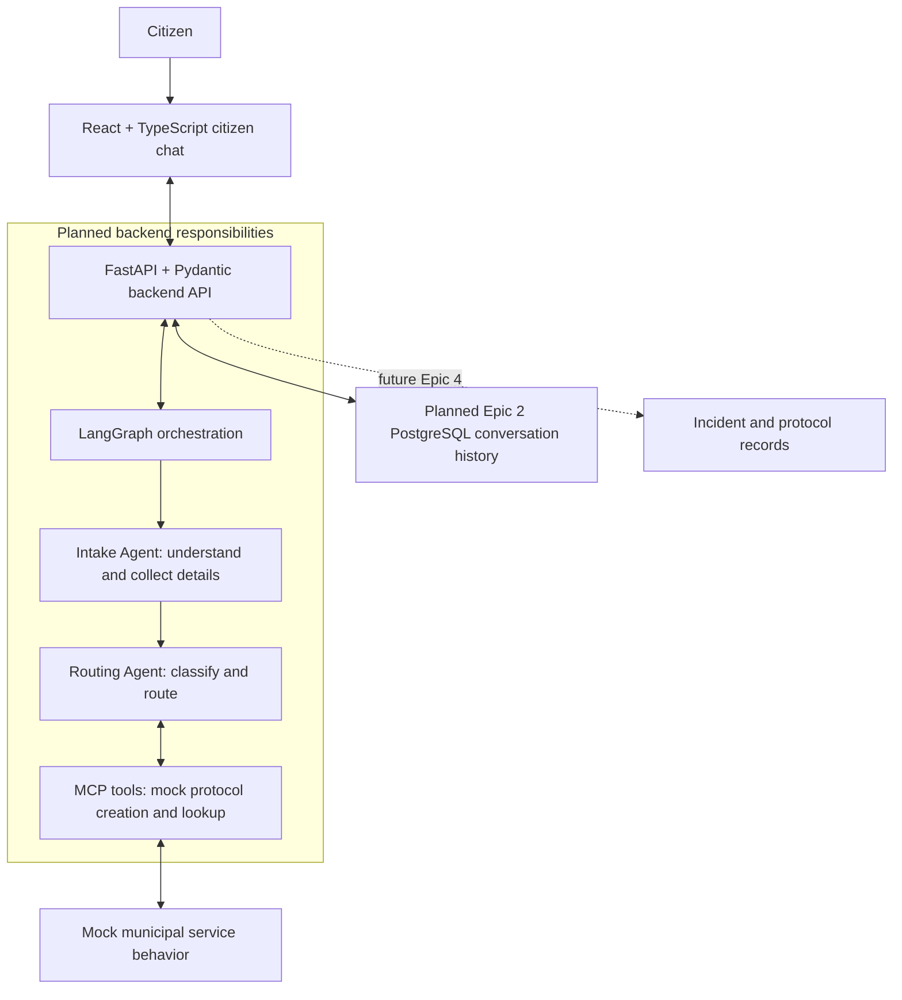

# Architecture

CivicFlow's target MVP is a text-based, AI-assisted municipal incident and
service-request experience. This reference separates the working foundation
from planned capabilities; it does not define new API or storage contracts.

## Implemented today

| Component | Current responsibility |
| --- | --- |
| `frontend/` | React + TypeScript shell, Vite, native CSS and CSS Modules; coming-soon chat placeholder, Google login/logout and same-origin session bootstrap. Node.js 22 and npm. |
| `backend/` | Python 3.12, FastAPI, Pydantic v2 and uv; `GET /health` returns `{"status":"ok"}`, plus v1 Google OIDC BFF authentication with PostgreSQL sessions and reusable conversation storage. |
| `compose.yaml` | Local Vite and Uvicorn servers, source mounts, isolated dependency volumes, and backend health check, PostgreSQL and startup migrations. |
| `.github/workflows/ci.yml` | Independent `backend` and `frontend` checks for lint, formatting/type checks, tests, and frontend build as applicable. |

Each application owns its dependencies, lockfile, settings, tests, and tooling.
The root holds shared conventions and project documentation; `docs/` holds
cross-application references. Local secrets and generated artifacts stay out
of version control. Existing `.env.example` templates contain safe configuration;
browser `VITE_*` settings must never contain secrets.

## Development communication

`frontend/src/config/env.ts` reads `VITE_API_BASE_URL`, defaulting to `/api`. The shell
exposes this as a data attribute. Authentication uses same-origin `/api/v1` requests
through the Vite development proxy in `frontend/vite.config.ts`.

Vite forwards `/api` requests to `API_PROXY_TARGET` (default `http://localhost:8000`)
and strips the prefix: `/api/health` reaches backend `/health`. Compose sets the browser
API base to `/api` and the server-only target to `http://backend:8000`. Vite resolves
the Docker service hostname inside the Compose network; the browser uses `/api`. The
shell renders a recoverable authentication error when the backend is unavailable.
Production hosting and routing are not defined.

See the [root quickstart](../README.md#development-with-docker-compose),
[frontend guide](../frontend/README.md), and [backend guide](../backend/README.md)
for commands and configuration.

## Target MVP components (planned)

Authentication is implemented; see [auth development](auth-development.md) for its
SQLAlchemy/Alembic foundation, security configuration and #21 conventions. All
request-processing connections below are planned. PostgreSQL persists users, identities,
sessions and login transactions. Conversation/message/attempt storage is implemented
in #21; its HTTP API and streaming remain planned in Epic #2. See
[storage design](conversation-storage.md). Municipal incident/protocol persistence
belongs to Epic #4.

| Planned component | Responsibility and boundary |
| --- | --- |
| Citizen chat | Collect text input and display follow-up questions and results. The browser communicates with the backend; orchestration and tool access belong behind the API. |
| Backend API | Validate inputs and outputs with Pydantic and coordinate the interaction. Planned v1 contracts are defined in [API contracts](api-contracts.md); no chat endpoints are implemented. |
| LangGraph orchestration | Coordinate the Intake Agent, which understands requests and collects missing details, and the Routing Agent, which classifies and routes them. LangGraph is not installed yet. |
| MCP tools | Provide mock municipal protocol creation and lookup behind a tool boundary. No MCP implementation or live government-system integration exists. |
| Conversation persistence (Epic #2) | PostgreSQL stores users, linked identities, sessions, conversations, messages and attempts. The shared ORM/migration foundation exists for authentication; conversation/message/attempt models and additive migration are implemented in #21. |
| Municipal persistence (Epic #4) | Future incident/protocol records; outside the conversation-history scope. |

## Anticipated citizen-request flow

1. A citizen describes an incident or service request in the planned chat.
2. The frontend sends the interaction to the backend API.
3. LangGraph coordinates the Intake Agent to understand the request and ask
   for missing details through the chat.
4. The Routing Agent classifies and routes the request, using MCP tools for
   mock municipal protocol creation or lookup as appropriate.
5. The backend returns the result for the chat to display, such as a mock
   protocol reference or status in later epics. Epic #2 first provides persisted
   conversation history with deterministic mock assistant replies and no real
   protocol creation; durable storage exists, but chat endpoints remain planned.

Planned authentication, conversation and streaming contracts for Epic #2 are defined in
[API contracts](api-contracts.md), [authentication](authentication.md) and [POST/SSE
streaming](streaming.md). They specify Google OIDC with BFF sessions, ownership checks,
locale boundaries and complete paginated history; authentication is implemented as
described in [auth development](auth-development.md); conversation and streaming
endpoints remain planned. PostgreSQL is selected for conversation history. AI providers,
agent routing rules and production infrastructure remain unspecified. Geospatial
analysis, multimodal input, and monitoring/oversight are future ideas outside the
current MVP scope.
